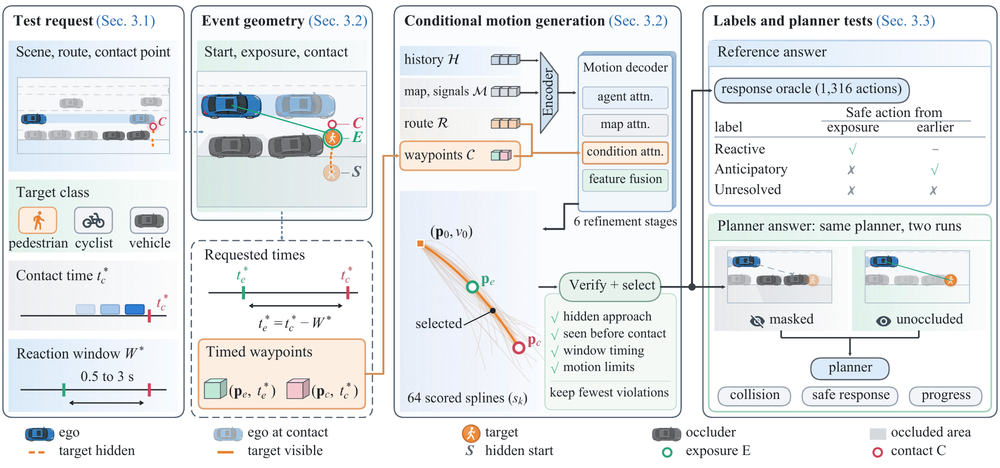
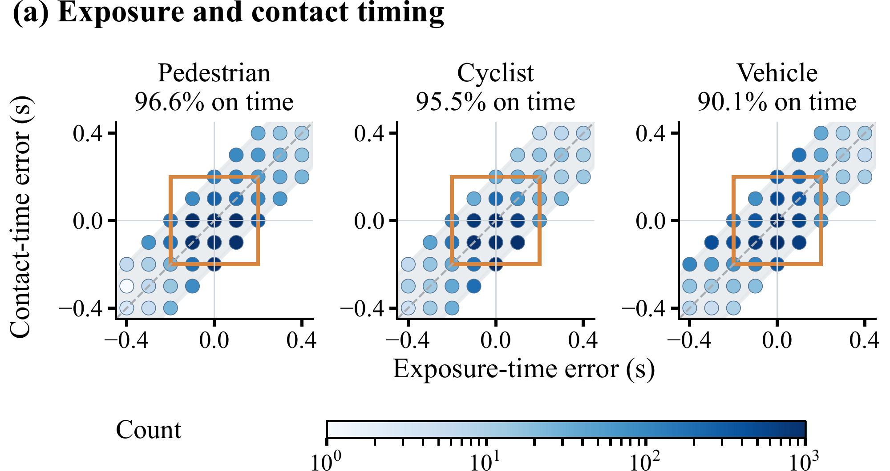
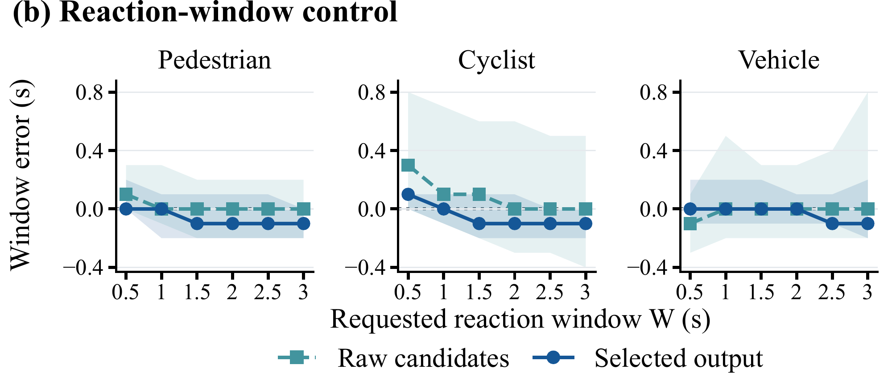
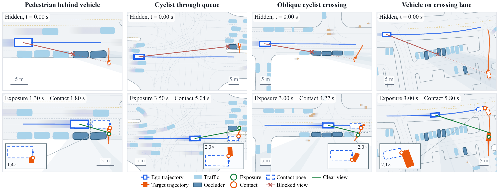
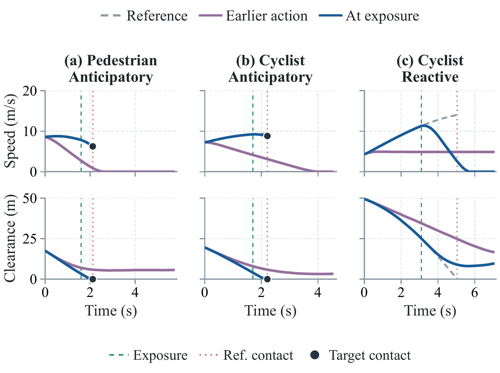
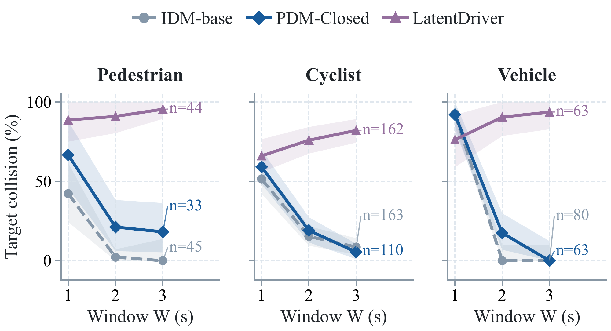
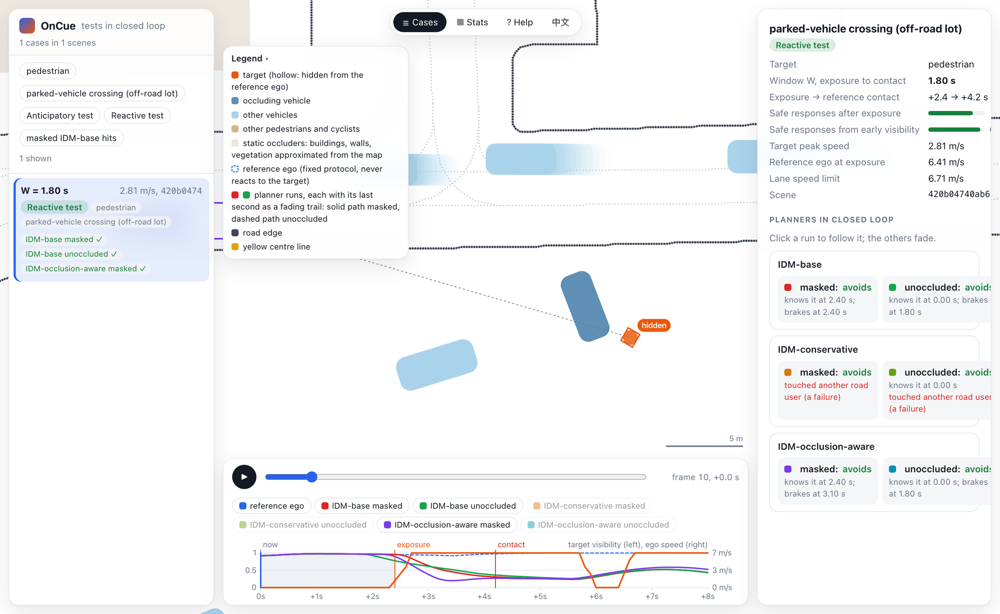

<p align="center">
  <picture>
    <source media="(prefers-color-scheme: dark)" srcset="assets/logo-dark.svg">
    
  </picture>
</p>

<h3 align="center">Generating Safety-Critical Driving Scenarios under Occlusion with Temporal Control</h3>

<p align="center">
  Kailang Ma<sup>1</sup>, Li Song<sup>2</sup>, Weining Ren<sup>3</sup>, Zirui Li<sup>4</sup>, Xianjie Dai<sup>1</sup>,
  Jingguang Li<sup>1</sup>, Zuyi Guo<sup>1</sup>, Benwang Chen<sup>1</sup>, Heye Huang<sup>1&dagger;</sup>
</p>

<p align="center">
  <sup>1</sup> Korea Advanced Institute of Science and Technology<br>
  <sup>2</sup> Giga<br>
  <sup>3</sup> The Chinese University of Hong Kong<br>
  <sup>4</sup> Nanyang Technological University
</p>

<p align="center"><i><sup>&dagger;</sup>Corresponding author</i></p>

<p align="center">
  <a href="#">Paper (arXiv, coming soon)</a> &nbsp;|&nbsp;
  <a href="https://mankasto.github.io/oncue/">Project page</a> &nbsp;|&nbsp;
  <a href="#installation">Installation</a> &nbsp;|&nbsp;
  <a href="#generating-labeling-and-evaluating-tests">Quick start</a> &nbsp;|&nbsp;
  <a href="#testing-your-own-planner">Your planner</a> &nbsp;|&nbsp;
  <a href="#citation">Citation</a>
</p>

<p align="center">
  
  
  
</p>

> [!NOTE]
> **📢 News**
> - **[2026/11]** Code released: test generation, response labeling and closed-loop planner evaluation on the
>   Waymo Open Motion Dataset. The paper will be on arXiv soon.

## 💡 Introduction

Occluded hazards challenge autonomous driving because visibility timing determines available avoidance actions.
Existing scenario generators control hazard motion without jointly specifying exposure and reference-contact times.
OnCue is a framework that generates safety-critical encounters in real driving logs with these temporal conditions.
Scene geometry provides hidden starts and timed waypoints for pedestrian, cyclist, and vehicle trajectory generation.
An offline response oracle labels encounters as Reactive (avoidable after exposure) or Anticipatory (avoidable only
with earlier visibility) and stores safe maneuvers as training demonstrations.

Our contributions:

- **Temporally controlled occlusion tests.** A framework for generating safety-critical driving scenarios under
  occlusion with temporal control, for evaluating planner responses as hidden hazards become visible earlier or later.
- **Geometry-guided conditional trajectory generation.** Constructed hidden starts and timed waypoints combined with
  learned motion generation; a planner-independent response oracle labels the available avoidance and stores
  executable demonstrations.
- **Planner evaluation and adaptation.** Closed-loop experiments across target classes and planners show how the
  available reaction time affects driving behavior, and training with the oracle's demonstrations improves target
  avoidance.

<p align="center">
  
  <sub><b>OnCue framework.</b> Timed conditions guide generation, followed by response labeling and planner evaluation.</sub>
</p>

## 📊 Results

**Temporal control.** On the Waymo Open Motion Dataset, 90.1% to 96.6% of valid trajectories meet both requested
times within ±0.2 s.

<p align="center">
  
  
</p>

<p align="center"><sub>(a) Exposure and contact timing errors and percentages for valid outputs; orange marks both
errors within ±0.2 s, gray the 0.2 s window tolerance. (b) Median window error with 10th to 90th percentile bands; raw
candidates are evaluated before checks at the first constructed start.</sub></p>

**Comparison with adversarial generators.** OnCue matches the requested reaction window in 92.8% of shared vehicle
requests versus at most 42.1% for adapted adversarial generators (2,624 shared requests from 446 logs, selected from
valid OnCue outputs; collision and adversarial reward against masked PDM-Closed; the full table with motion quality is
in the paper):

| Method | W match (%) ↑ | Coverage (%) ↑ | PDM-Closed collision (%) ↑ | Adv. reward ↑ |
| --- | ---: | ---: | ---: | ---: |
| [CAT](https://github.com/metadriverse/cat) | 26.8 | 57.5 | 19.4 | 0.943 |
| [KING](https://github.com/autonomousvision/king) | 42.1 | 57.3 | 12.0 | 0.707 |
| [GOOSE](https://doi.org/10.1109/itsc58415.2024.10919498) | 38.9 | 47.2 | 9.2 | 0.576 |
| [SEAL](https://github.com/cmubig/SEAL) | 22.2 | 49.9 | 12.5 | 0.609 |
| [SAGE](https://github.com/tongnie/SAGE) (w = 0.5) | 11.6 | 22.9 | 8.7 | 0.478 |
| [SAGE](https://github.com/tongnie/SAGE) (w = 1.0) | 5.6 | 13.8 | 8.2 | 0.473 |
| OnCue (rule) | 81.7 | 86.7 | 22.9 | 1.076 |
| **OnCue (model)** | **92.8** | **92.6** | **34.1** | **1.333** |

<p align="center">
  
  <sub><b>Generated occluded encounters across pedestrian, cyclist, and vehicle scenarios.</b> The top row shows hidden
  approaches, while the bottom row shows first exposure before reference contact.</sub>
</p>

**Response labels and planners.** Across matched cyclist encounters, longer windows lower PDM-Closed collision from
59.1% to 5.5%, while the learned planner LatentDriver shows the opposite trend. OnCue demonstrations reduce
LatentDriver target collision by 54.8 points on held-out Reactive tests, but reduce overall no-target progress by
12.7 m.

<p align="center">
  
  
</p>

<p align="center"><sub>Left: <b>oracle action timing.</b> In (a, b), the same braking action is safe when started at
t<sub>v</sub> (purple) and collides when started at exposure (blue); in (c), the post-exposure action is safe. Right:
<b>response time separates planner behavior.</b> Target collision under masked observations; bands are pointwise 95%
driving-episode bootstrap intervals.</sub></p>

<a name="installation"></a>

## 🛠️ Installation

```bash
conda env create -f environment.yml
conda activate oncue
python -m metadrive.pull_asset    # MetaDrive's assets, only for drawing runs in MetaDrive
```

On macOS, NumPy 2.2 with Apple's Accelerate may print `RuntimeWarning: ... encountered in matmul`; the outputs are
unaffected (generation and labels match those under NumPy 2.5, which prints no such warning).

On a Linux machine, `bash tools/setup_env.sh` builds the same environment and checks it. Reading OnCue's outputs
(the examples below) needs only five packages:

```bash
pip install numpy==2.2.6 scipy==1.13.1 shapely==2.1.2 protobuf==6.33.5 google-crc32c==1.9.0
export PYTHONPATH=$PWD/src
```

## 📦 Data and models

- **WOMD v1.3.1.** Download the scenario TFRecords from [waymo.com/open](https://waymo.com/open) under the dataset's
  license; OnCue reads them as they are.
- **Trajectory generator.** The learned trajectory generator (`weights/trajectory_generator.pt`) is not released with
  the code. Train it with `tools/train.sh`
  ([weights/README.md](weights/README.md)), or use rule-based generation (`--generators rule`), which needs no
  model.
- **Planner checkpoints.** LatentDriver and PlanT come from LatentDriver's release; IDM and PDM-Closed need none
  ([weights/README.md](weights/README.md)).

<a name="generating-labeling-and-evaluating-tests"></a>

## 🚀 Generating, labeling and evaluating tests

One validation shard and one target type, from the repository root:

```bash
python -m oncue export $WOMD/validation.tfrecord-00012-of-00150 --out scenes
python -m oncue generate scenes --spec pedestrian --generators rule --out generated.jsonl
python -m oncue label generated.jsonl scenes --spec pedestrian --out labels.jsonl
python -m oncue closedloop labels.jsonl scenes --spec pedestrian \
  --planners reactive,conservative,occlusion_aware,pdm_closed --out closedloop.jsonl
```

- `generate` builds requests from the scene geometry (hidden starts and timed waypoints) and keeps the trajectories
  that pass the hard checks. `--generators rule` is rule-based generation, which needs no model; with a trained
  trajectory generator, replace it with `--model weights/trajectory_generator.pt`, which runs the trajectory
  generator and rule-based generation.
- `label` runs the response oracle and stores the safe responses it finds.
- `closedloop` replays each test with each planner, masked and unoccluded. Planners: `reactive`, `conservative` and
  `occlusion_aware` (the IDM variants), `pdm_closed`, `latentdriver` and `plant` (with their checkpoints in
  `weights/`).
- Every output has a `.settings.json` beside it with the settings and the md5 of its inputs; a rerun of the same
  command resumes it. `python -m oncue <command> --help` lists the options.

`python -m oncue cases` draws the tests and runs as an offline web page ([Browsing the tests](#browsing-the-tests)). The parameter
values and where each comes from are in [PARAMETERS.md](PARAMETERS.md).

<a name="testing-your-own-planner"></a>

## 🧪 Testing your own planner

A planner is a class that the closed loop builds once per run and steps every 0.1 s;
[examples/my_planner.py](examples/my_planner.py) is a complete template.

- `__init__(scene, target_id, cfg, perception, v_des, rules)`: the logged scene, the target's id, the driver
  settings, the planner's perception, its desired speed and the traffic rules on its route.
- `state()`: the ego's state `(x, y, heading, speed)` at the test's start.
- `step(frame, ego_states, scene, beliefs)`: the state the planner wants one frame later; the same vehicle model and
  tracker as for the built-in planners execute it. `beliefs.states` maps each road user the ego knows to its state;
  under masked observation those are only the ones the ego has seen.
- After the run the closed loop reads `stations`, `speeds` and `accels` (one per step; `planners.step_records.StepRecords`
  keeps them) and `target_brake_s`, the first time the planner braked for the target (or `None`).

A module registers the planner under a name:

```python
from oncue.closedloop.execution import executed
from oncue.closedloop.registry import register, run_planner


def drive_mine(scene, target_id, cfg, **options):
    return run_planner(scene, target_id, cfg, executed(MyPlanner), **options)


register("mine", drive_mine)
```

Name that module with `--planner-module` and the planner with `--planners`, next to the built-in ones:

```bash
cd examples
python -m oncue closedloop ../labels.jsonl ../scenes --spec pedestrian \
  --planner-module my_planner --planners cautious,pdm_closed --out ../closedloop.jsonl
python collision_rates.py ../closedloop.jsonl --planners cautious,pdm_closed
```

The module is imported in every worker, so `--workers` works as for the built-in planners, and the output's settings
record the planner's module and function. The no-target progress (`nominal_4s`) is computed for the built-in planners
only.

<a name="browsing-the-tests"></a>

## 🔎 Browsing the tests

`oncue cases` turns label and closed-loop outputs into an offline case browser: the tests with filters by target type,
construction family, label and outcome, each replayed in its scene with the reference ego and every planner run, masked
and unoccluded, and a timeline of target visibility and ego speed.

```bash
python -m oncue cases labels.jsonl --scenes scenes --spec pedestrian --closed closedloop.jsonl --out cases
```

Open `cases/index.html` in a browser; every file is local. `--per-kind N` keeps up to N tests per target type, site kind
and label (4 by default). The cases are replayed from the scene shards, since the outputs keep outcomes, not
trajectories. `python -m oncue site site --cases cases` puts the browser in a small site with a home page;
[render/](src/oncue/render/README.md) has the details.

<p align="center">
  
</p>

## 🧩 Examples

[examples/](examples/README.md) has three short scripts on OnCue's public modules: counting the tests of a label
output by type, label and window; replaying one test with one planner; and collision rates by type, label and planner
with 95% intervals. It also holds the planner template, `my_planner.py`.

## 🗂️ Repository layout

| Folder | What it holds |
| --- | --- |
| `src/oncue/core` | Scene and test records, configuration, visibility, kinematics, road and fault rules, input and output |
| `src/oncue/data` | Reading WOMD shards into scenes, map geometry, log statistics |
| `src/oncue/generation` | Requests, hidden starts, timed waypoints, target motion, the reference ego and the hard checks |
| `src/oncue/models` | The trajectory generator and its training |
| `src/oncue/oracle` | The response oracle: response labels and safe demonstrations |
| `src/oncue/closedloop` | Closed-loop replay of tests against planners |
| `src/oncue/planners` | IDM variants, PDM-Closed, LatentDriver and PlanT |
| `src/oncue/evaluate` | Rates, intervals and run outcomes |
| `src/oncue/render` | Case viewer and offline site |
| `examples/`, `tools/` | Example scripts; environment and training scripts |

<a name="citation"></a>

## 📝 Citation

The citation will be updated with the arXiv version.

```bibtex
@article{oncue2026,
  title   = {OnCue: Generating Safety-Critical Driving Scenarios under Occlusion with Temporal Control},
  author  = {Ma, Kailang and Song, Li and Ren, Weining and Li, Zirui and Dai, Xianjie and Li, Jingguang and
             Guo, Zuyi and Chen, Benwang and Huang, Heye},
  journal = {arXiv preprint},
  year    = {2026}
}
```

## 🙏 Acknowledgements

OnCue builds on the [Waymo Open Motion Dataset](https://waymo.com/open), PDM-Closed from
[tuplan_garage](https://github.com/autonomousvision/tuplan_garage), [LatentDriver](https://github.com/Sephirex-X/LatentDriver),
[MTR](https://github.com/sshaoshuai/MTR) and [MetaDrive](https://github.com/metadriverse/metadrive); see
[NOTICE.md](NOTICE.md) for the code included from them.

## 📄 License

OnCue is released under the Apache License 2.0 ([LICENSE](LICENSE)); the third-party code it includes keeps its own
license ([NOTICE.md](NOTICE.md)).

**Waymo Open Dataset.** This software was made using the Waymo Open Dataset, provided by Waymo LLC under the Waymo Dataset License Agreement for Non-Commercial Use, available at waymo.com/open/terms, and your access and use of such work are governed by the terms and conditions therein.
